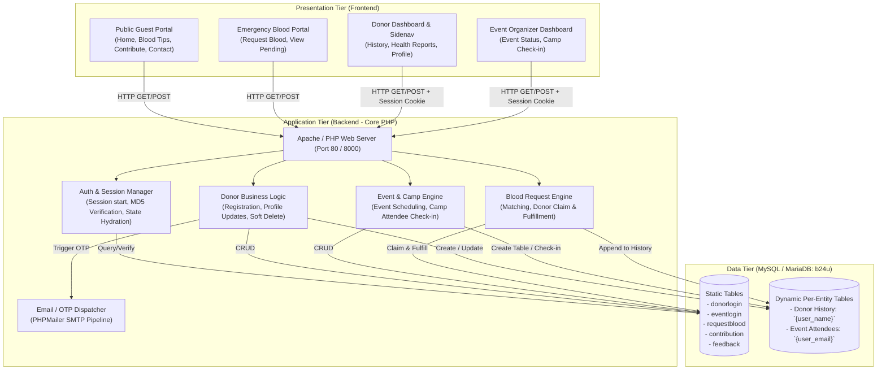
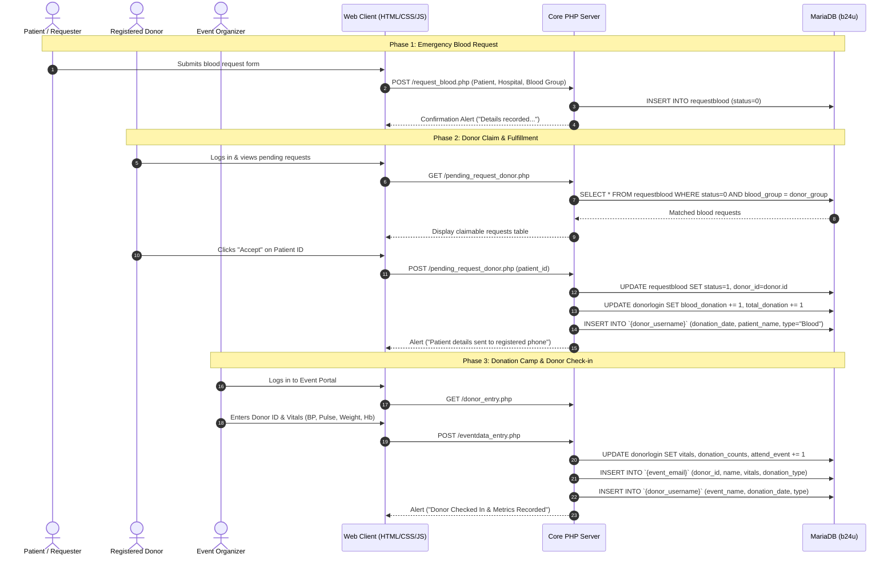

# 🩸 B24U Blood Donation Management System — System Architecture & Workflow Guide

Welcome to the comprehensive workflow documentation for the **B24U (Blood 24 You) Blood Donation Management System**. This directory contains detailed architectural diagrams, process flows, state machines, and technical blueprints covering the Frontend, Backend, and Database tiers of the system.

---

## 📁 Workflow Documentation Structure

| Document | Focus Area | Description |
| :--- | :--- | :--- |
| **[`frontend-workflow.md`](frontend-workflow.md)** | **Presentation Tier** | User personas, portal navigation, client-side validation rules, responsive layouts, sidebar states, and page routing. |
| **[`backend-workflow.md`](backend-workflow.md)** | **Application Tier** | Procedural PHP processing lifecycle, session hydration, authentication & OTP email pipeline, business logic, and security controls. |
| **[`database-workflow.md`](database-workflow.md)** | **Data Tier** | Complete ERD, static table schemas (`donorlogin`, `eventlogin`, `requestblood`, `contribution`, `feedback`), dynamic per-user/event tables, and data lifecycles. |
| **[`frontend-modernization-architecture.md`](frontend-modernization-architecture.md)** | **HemoNexus Modernization** | UNESCO-inspired UI design system, glassmorphic palette, typography, biometric gauges, and decoupled SPA architecture. |
| **[`security-authentication-workflow.md`](security-authentication-workflow.md)** | **Full-Stack Security** | Session guards, workspace isolation engine, `auth_status.php` introspection, CSRF mitigation, and session flush handlers. |
| **[`data-integration-workflow.md`](data-integration-workflow.md)** | **Data Integration** | URLSearchParams HTTP client, two-step OTP verification, emergency request broadcast, donor claim, camp check-in, and dynamic MariaDB queries. |

---

## 🏗️ High-Level System Architecture

The B24U portal is architected using a traditional LAMP/WAMP stack (Linux/Windows, Apache, MySQL/MariaDB, Core PHP) with procedural scripting and session-driven state management.

---

## 🔄 End-to-End User Journey Overview

---

## 🔐 Key System Characteristics

1. **Procedural Modular Scripts**: Every action has a dedicated handling script (e.g. `eventdata_entry.php`, `process.php`, `connection.php`).
2. **Dual-Portal Access**: Dedicated dashboards for Donors (`donor_page.php`, `health_report.php`) and Event Organizers (`event_status.php`, `donor_entry.php`).
3. **Dynamic Tabular Storage**: In addition to static relational tables, the database dynamically provisions isolated history tables per donor and attendee tables per event organizer.
4. **Soft Deletions**: User accounts are retired using `status = 1` flags to preserve historical audit trails before dynamic tables are detached.
