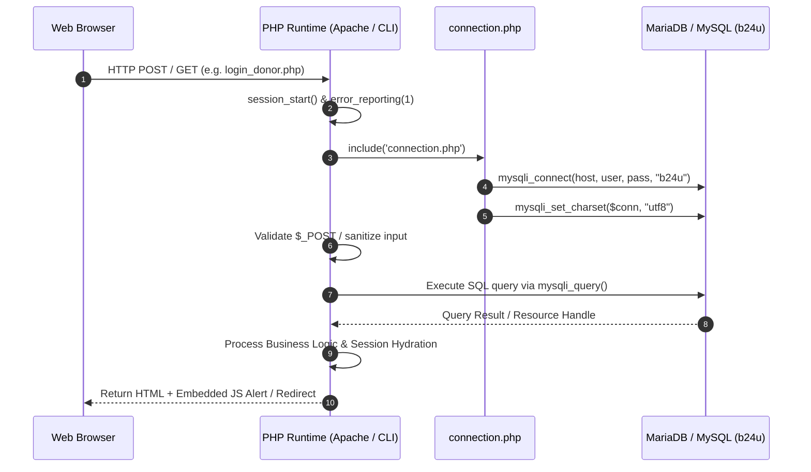
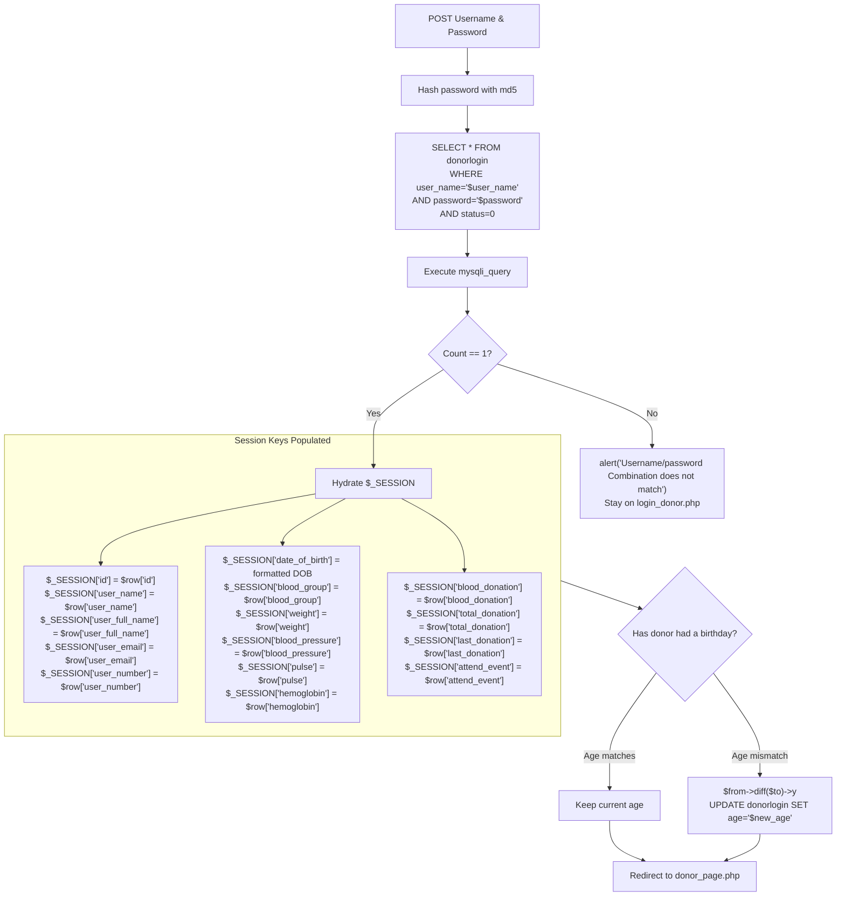
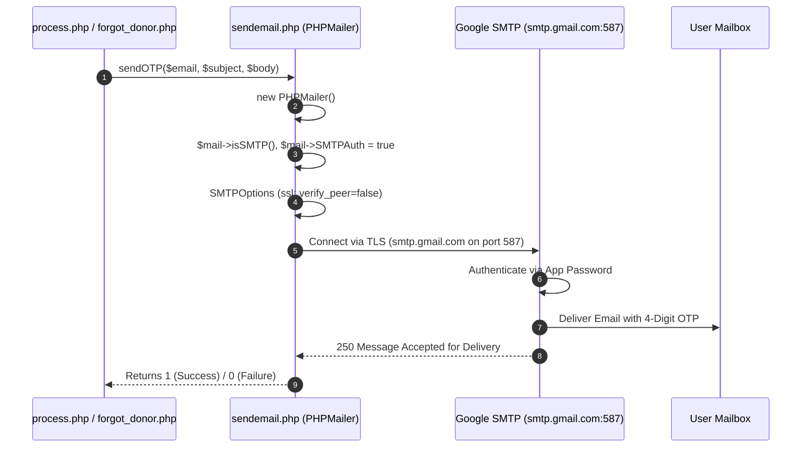
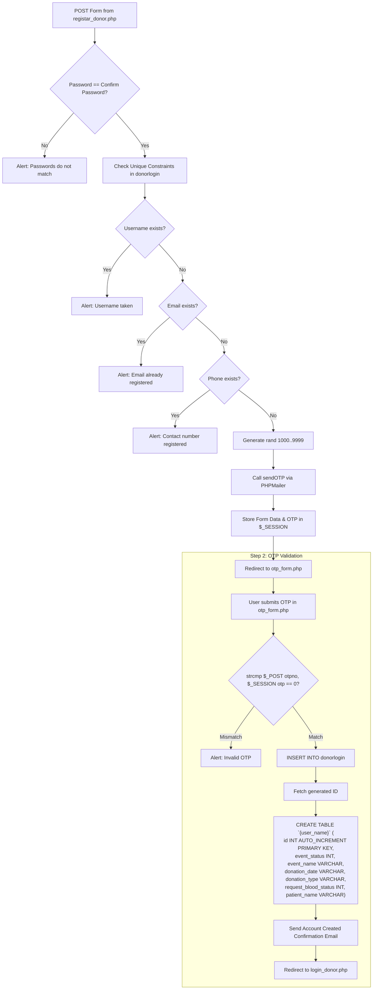
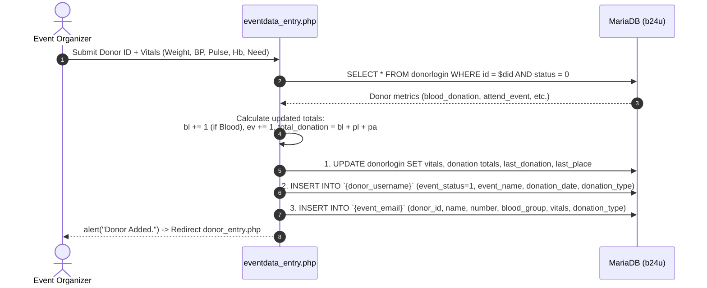
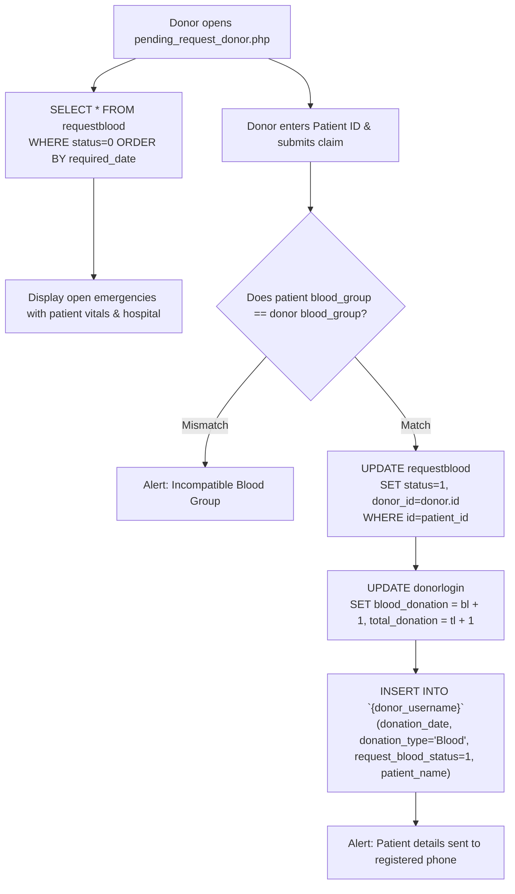

# ⚙️ Backend Workflow — B24U Blood Donation Management System

This document outlines the server-side architecture, procedural request lifecycle, session hydration mechanisms, core business workflows, and security operations implemented across the PHP backend.

---

## 🏗️ Backend Execution Model & Runtime

The backend is built with Core PHP, executing procedurally through Apache or the PHP CLI development server. Every request follows a standard execution cycle:



---

## 🔐 Authentication & Session Engine

### 1. Donor Authentication & Session Hydration (`login_donor.php`)

When a donor logs in, credentials are verified against `donorlogin` where `status = 0` (active account). Upon verification, the session is populated with comprehensive donor metrics:



### 2. Event Organizer Authentication (`login_event.php`)

Similar to donor authentication, event organizer sessions are validated against `eventlogin`:
- Credentials verified: `user_email` and `md5(password)` where `status = 0`.
- Session hydrated with: `$_SESSION['id']`, `$_SESSION['user_full_name']`, `$_SESSION['user_email']`, `$_SESSION['user_number']`, `$_SESSION['event_date']`, `$_SESSION['start_time']`, `$_SESSION['end_time']`, `$_SESSION['city']`.
- Redirects to `event_status.php`.

### 3. Session Termination (`signout_donor.php` / `signout_event.php`)
Both scripts execute:
```php
session_start();
session_destroy();
echo "<script> alert('Logout Successfully'); window.location = 'login_donor.php'; </script>";
```

---

## 📧 Email & OTP Dispatch Pipeline (`sendemail.php`)

The email delivery subsystem utilizes **PHPMailer** via SMTP to deliver verification OTPs and account confirmation letters:



---

## ⚙️ Core Business Logic Modules

### 1. Donor Registration & Two-Step OTP Verification (`process.php`)



### 2. Event Camp Check-in & Metrics Sync (`eventdata_entry.php`)

When an event organizer checks in a donor at a blood camp, `eventdata_entry.php` performs an atomic sequence across three database structures:



### 3. Blood Request Claim & Matching Engine (`pending_request_donor.php`)



### 4. Account Soft-Deletion Engine (`delete_donor.php` / `delete_event.php`)

The deletion workflow ensures user records are deactivated safely while cleaning up dynamic tables:
1. Updates record status to inactive:
   ```sql
   UPDATE donorlogin SET status = 1 WHERE user_name = '$_SESSION[user_name]'
   ```
2. Drops the associated personal history table:
   ```sql
   DROP TABLE `$_SESSION[user_name]`
   ```
3. Destroys the session and routes back to login.

---

## 🔒 Security Architecture & Recommendations

| Aspect | Current Implementation | Production Hardening Recommendation |
| :--- | :--- | :--- |
| **Password Hashing** | `md5($password)` | Upgrade to `password_hash($pass, PASSWORD_BCRYPT)` |
| **SQL Execution** | Direct string concatenation with `mysqli_query` | Migrate to prepared statements (`$stmt = $conn->prepare(...)`) |
| **Session Protection** | Default PHP sessions | Add `session_regenerate_id(true)` and `HttpOnly; SameSite=Strict` cookies |
| **Input Sanitization** | Basic client regex validation | Add server-side `filter_var()`, `htmlspecialchars()`, and CSRF tokens |
| **Error Handling** | `error_reporting(1)` | Configure `display_errors = Off` and log errors to `error.log` in production |
