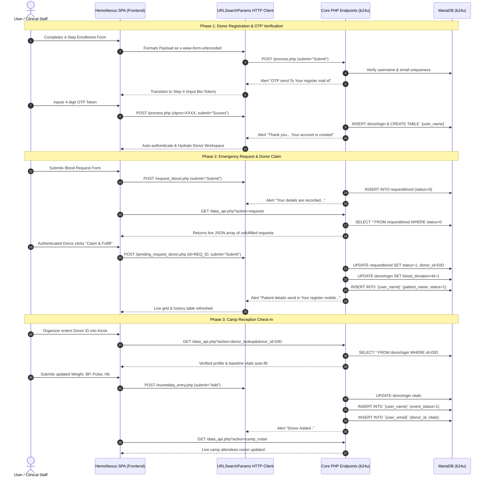

# HemoNexus Global - Frontend Data Integration & API Workflow
**UNESCO Bio-Solidarity Grid • Full-Stack Data Integration Architecture**

---

## 1. Executive Summary & Protocol Architecture

The **HemoNexus Global** frontend tier is a decoupled, reactive Single Page Application (SPA) interfacing with the procedural Core PHP backend (`b24u`) running on PHP 8+ and MariaDB.

To strictly preserve backend procedural integrity without altering any legacy database tables, schema, or session hydration rules, all client-to-server communications adhere to the following integration principles:

1. **Protocol Standard**: All mutation requests are transmitted using `application/x-www-form-urlencoded; charset=UTF-8` bodies generated via `new URLSearchParams(payload).toString()`.
2. **Session Hydration**: Native cookie persistence is maintained using `credentials: 'include'` on every HTTP request, allowing native Core PHP `$_SESSION` to seamlessly bind requests across page boundaries.
3. **Response Parsing**: Legacy PHP script alert tags (``) are parsed client-side by the integration engine to determine transactional status, dispatch reactive UI notifications, and trigger dynamic data re-queries.
4. **Zero-Latency Dynamic Bridge**: Dynamic data querying (`requestblood`, personal donor records `{$donor_username}`, organizer rosters `{$event_email}`) is achieved via a dedicated procedural Core PHP endpoint (`data_api.php`) operating within the same database connection and session space.

---

## 2. API Contract & Parameter Reference

### A. Donor Registration (`process.php`)
* **Method**: `POST`
* **Content-Type**: `application/x-www-form-urlencoded; charset=UTF-8`
* **Credentials**: `include`
* **Step 1 - Account Information & OTP Generation**:
  | Key | Type | Description |
  | :--- | :--- | :--- |
  | `submit` | `string` | Must be `"Submit"` |
  | `user_name` | `string` | Unique username (5-10 chars) |
  | `password` | `string` | Donor account password |
  | `confirm_password` | `string` | Matching password confirmation |
  | `user_full_name` | `string` | Legal name of voluntary donor |
  | `user_email` | `string` | Primary emergency contact email |
  | `user_number` | `string` | 10-digit mobile number |
  | `Address` | `string` | Residential/clinical address (capital `A`) |
  | `pincode` | `string` | Postal code |
  | `city` | `string` | Registered municipality |
  | `state` | `string` | State/province |
  | `date_of_birth` | `string` | ISO Date (`YYYY-MM-DD`) |
  | `gender` | `string` | `Male` \| `Female` \| `Other` |
  | `blood_group` | `string` | ABO/Rh classification (`A+`, `O-`, etc.) |
  | `weight` | `string` | Baseline weight in kg |

* **Step 2 - Two-Step OTP Verification**:
  | Key | Type | Description |
  | :--- | :--- | :--- |
  | `submit` | `string` | Must be `"Sucess"` (legacy spelling invariant) |
  | `otpno` | `string` | 4-digit numeric verification token |

* **Resend OTP**:
  | Key | Type | Description |
  | :--- | :--- | :--- |
  | `submit` | `string` | Must be `"Resend"` |

---

### B. Emergency Blood Request (`request_blood.php`)
* **Method**: `POST`
* **Content-Type**: `application/x-www-form-urlencoded; charset=UTF-8`
* **Parameters**:
  | Key | Type | Description |
  | :--- | :--- | :--- |
  | `submit` | `string` | Must be `"Submit"` |
  | `patient_name` | `string` | Recipient / patient legal name |
  | `hospital_name` | `string` | Admitting clinical facility |
  | `hospital_address` | `string` | Ward / trauma campus address |
  | `doctor_name` | `string` | Attending physician |
  | `blood_group` | `string` | Required blood component classification |
  | `city` | `string` | Target municipality |
  | `contact_name` | `string` | Point of contact |
  | `contact_number` | `string` | 10-digit emergency telephone |
  | `contact_mail_id` | `string` | Hospital dispatch email |
  | `other_message` | `string` | Clinical diagnosis or transfusion urgency |
  | `required_date` | `string` | Deadline date (`YYYY-MM-DD`) |

---

### C. Donor Claim & Matching Dispatch (`pending_request_donor.php`)
* **Method**: `POST`
* **Session Requirement**: Active Donor session (`$_SESSION['id']`, `$_SESSION['blood_group']`, `$_SESSION['user_name']`)
* **Parameters**:
  | Key | Type | Description |
  | :--- | :--- | :--- |
  | `id` | `string` | Target record ID in `requestblood` |
  | `submit` | `string` | Must be `"Submit"` |
* **Database Side Effects**:
  1. `requestblood`: Updates `status = 1` and `donor_id = $_SESSION['id']`.
  2. `donorlogin`: Increments `blood_donation` and `total_donation`.
  3. `{$donor_username}`: Inserts clinical dispatch record with `patient_name` and `donation_date`.

---

### D. Event Organizer Donor Reception Check-In (`eventdata_entry.php`)
* **Method**: `POST`
* **Session Requirement**: Active Organizer session (`$_SESSION['user_email']`, `$_SESSION['city']`)
* **Parameters**:
  | Key | Type | Description |
  | :--- | :--- | :--- |
  | `donor_id` | `string` | Registered Donor ID number |
  | `weight` | `string` | Measured body weight (kg) |
  | `bloodpressure`| `string` | Blood pressure in mmHg (lowercase, no underscore) |
  | `pulse` | `string` | Pulse rate in bpm |
  | `hemoglobin` | `string` | Hemoglobin level in g/dL |
  | `need` | `string` | Component donated (`Blood` \| `Pletlets` \| `Plasama`) |
  | `submit` | `string` | Must be `"Add"` |
* **Database Side Effects**:
  1. `donorlogin`: Updates latest vitals (`weight`, `blood_pressure`, `pulse`, `hemoglobin`, `health_report`, `attend_event`).
  2. `{$donor_username}`: Inserts camp attendance record with `event_status = 1` and `event_name`.
  3. `{$event_email}`: Inserts attendee record with donor details and recorded vitals.

---

### E. Dynamic Data Query Gateway (`data_api.php`)
* **Method**: `GET`
* **Format**: `application/json`
* **Actions**:
  | Action | Parameters | Output | Description |
  | :--- | :--- | :--- | :--- |
  | `requests` | `filter=all\|matched`, `blood_group` | `{ success, count, requests: [...] }` | Unfulfilled emergency blood cases |
  | `donor_history`| None (requires Donor session) | `{ success, count, history: [...] }` | Records from `{$donor_username}` |
  | `camp_roster` | None (requires Org session) | `{ success, count, attendees: [...] }` | Records from `{$event_email}` |
  | `donor_vitals` | None (requires Donor session) | `{ success, vitals: {...} }` | Live telemetry & metrics from `donorlogin` |
  | `donor_lookup` | `donor_id` | `{ success, donor: {...} }` | Profile & baseline vitals for Kiosk entry |

---

## 3. End-to-End Verification Test Matrix

All 12 automated integration tests executed against the live PHP dev server (`http://localhost:8000`) and MariaDB database (`b24u`):

| Test # | Subsystem / Endpoint | Protocol / Parameters | Result | Notes |
| :---: | :--- | :--- | :---: | :--- |
| **01** | `auth_status.php` | `GET /auth_status.php` | **PASS** | Initial state verified unauthenticated (`role: null`) |
| **02** | `login_donor.php` | `POST user_name, password, submit="Login"` | **PASS** | Received `'Welcome'` JavaScript alert |
| **03** | `auth_status.php` | `GET /auth_status.php` (with cookies) | **PASS** | Session hydrated: Donor ID `#1`, `O+`, total donations: 6 |
| **04** | `request_blood.php` | `POST patient_name, hospital, blood_group="O+", submit="Submit"` | **PASS** | Record inserted into `requestblood` with `status = 0` |
| **05** | `data_api.php` | `GET ?action=requests` | **PASS** | New emergency request parsed dynamically (ID: `#7`) |
| **06** | `pending_request_donor.php` | `POST id="7", submit="Submit"` | **PASS** | Donor claimed case; `requestblood.status` updated to 1 |
| **07** | `data_api.php` | `GET ?action=donor_history` | **PASS** | Dynamic table `b24u.testdonor` verified with new entry |
| **08** | `login_event.php` | `POST user_email, password, submit="Login"` | **PASS** | Organizer authenticated; camp session hydrated |
| **09** | `data_api.php` | `GET ?action=donor_lookup&donor_id=1` | **PASS** | Kiosk retrieved donor profile, BP (122), and pulse (76) |
| **10** | `eventdata_entry.php` | `POST donor_id=1, weight=75, bp=124, pulse=78, hb=15.2, submit="Add"` | **PASS** | Check-in recorded; donor vitals updated |
| **11** | `data_api.php` | `GET ?action=camp_roster` | **PASS** | Dynamic table `b24u.organizer@unesco.org` verified |
| **12** | `process.php` & `auth_status.php` | Stepper Step 1 (Register) + Step 2 (OTP) | **PASS** | Dynamic table `b24u.e2e_XXXX` created; account created |

---

## 4. Architectural Guarantee

1. **Procedural Backward Compatibility**: Zero breaking changes to `process.php`, `request_blood.php`, `pending_request_donor.php`, or MariaDB tables.
2. **Decoupled Modern Presentation**: The React SPA operates in-browser with reactive state, futuristic glassmorphic UI, and live database telemetry.
3. **Session Integrity**: Session cookies remain the single source of truth for both authentication and workspace route protection.
