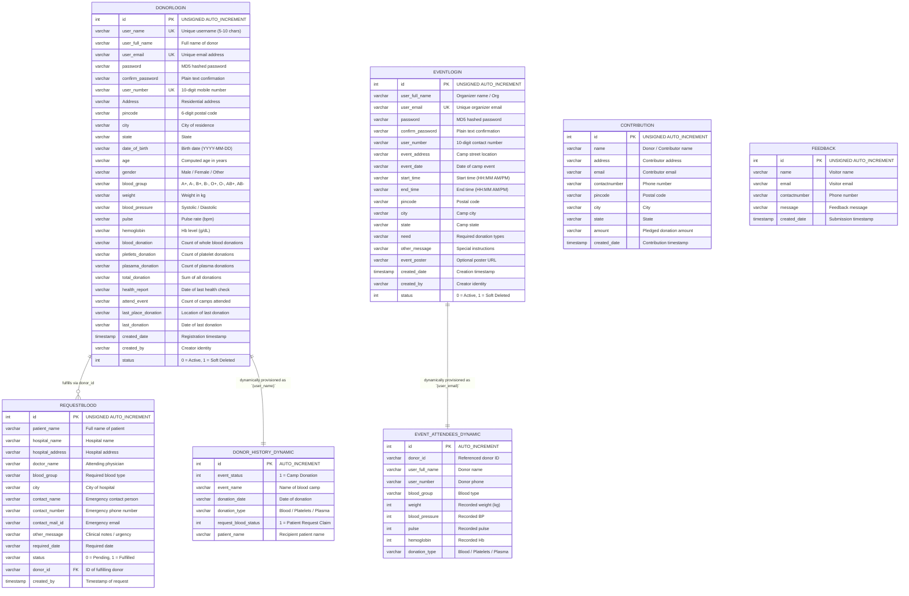
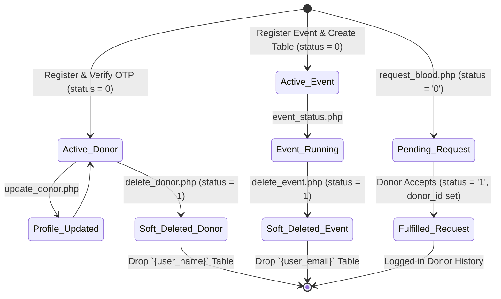

# 🗄️ Database Workflow — B24U Blood Donation Management System

This document provides a comprehensive blueprint of the database architecture, entity relationships, static schemas, dynamic table patterns, CRUD query matrices, and state machine lifecycles for the `b24u` database.

---

## 📊 Database Specifications

- **Database Name**: `b24u`
- **Default Character Set**: `utf8mb4` (or `latin1` legacy)
- **Collation**: `utf8mb4_general_ci`
- **Storage Engine**: `InnoDB`
- **Connection Configuration**: Configured in [`B24U_CorePHP_SourceFile/connection.php`](../Blood-Donation-PHP/B24U_CorePHP_SourceFile/connection.php).

---

## 🗺️ Entity-Relationship Diagram (ERD)



---

## 🗃️ Static Core Schemas

### 1. `donorlogin` Table
Stores donor user accounts, authentication credentials, physical vitals, and aggregated donation history counters.

| Column | Type | Nullable | Default | Description |
| :--- | :--- | :--- | :--- | :--- |
| `id` | `INT(255) UNSIGNED` | No | Auto-Increment | Primary Key |
| `user_name` | `VARCHAR(255)` | Yes | NULL | Unique login handle (5-10 characters) |
| `user_full_name` | `VARCHAR(255)` | Yes | NULL | Full legal name of donor |
| `user_email` | `VARCHAR(255)` | Yes | NULL | Unique contact email |
| `password` | `VARCHAR(255)` | Yes | NULL | MD5 password hash |
| `confirm_password` | `VARCHAR(255)` | Yes | NULL | Stored plain-text confirmation |
| `user_number` | `VARCHAR(255)` | Yes | NULL | 10-digit mobile contact |
| `Address` | `VARCHAR(255)` | Yes | NULL | Residential address |
| `pincode` | `VARCHAR(255)` | Yes | NULL | 6-digit postal code |
| `city` | `VARCHAR(255)` | Yes | NULL | Resident city |
| `state` | `VARCHAR(255)` | Yes | NULL | Resident state |
| `date_of_birth` | `VARCHAR(255)` | Yes | NULL | Date of birth (YYYY-MM-DD) |
| `age` | `VARCHAR(3)` | Yes | NULL | Dynamically updated age |
| `gender` | `VARCHAR(255)` | Yes | NULL | Gender |
| `blood_group` | `VARCHAR(255)` | Yes | NULL | ABO/Rh blood type (e.g., `O+`, `A-`) |
| `weight` | `VARCHAR(255)` | Yes | NULL | Weight in kilograms |
| `blood_pressure` | `VARCHAR(255)` | Yes | NULL | Blood pressure reading |
| `pulse` | `VARCHAR(255)` | Yes | NULL | Pulse rate in bpm |
| `hemoglobin` | `VARCHAR(255)` | Yes | NULL | Hemoglobin level in g/dL |
| `blood_donation` | `VARCHAR(255)` | Yes | NULL | Whole blood donation count |
| `pletlets_donation`| `VARCHAR(255)` | Yes | NULL | Platelet donation count |
| `plasama_donation` | `VARCHAR(255)` | Yes | NULL | Plasma donation count |
| `total_donation` | `VARCHAR(255)` | Yes | NULL | Total donations count |
| `health_report` | `VARCHAR(255)` | Yes | NULL | Date of last recorded health metrics |
| `attend_event` | `VARCHAR(255)` | Yes | NULL | Number of camp events attended |
| `last_place_donation`| `VARCHAR(255)`| Yes | NULL | City of last donation |
| `last_donation` | `VARCHAR(255)` | Yes | NULL | Date of last donation |
| `created_date` | `TIMESTAMP(6)` | Yes | NULL | Account creation timestamp |
| `created_by` | `VARCHAR(255)` | Yes | NULL | Creator name |
| `status` | `INT(1)` | Yes | `0` | `0` = Active, `1` = Soft Deleted |

---

### 2. `eventlogin` Table
Manages blood donation drive events, organizer credentials, and camp schedules.

| Column | Type | Nullable | Default | Description |
| :--- | :--- | :--- | :--- | :--- |
| `id` | `INT(255) UNSIGNED` | No | Auto-Increment | Primary Key |
| `user_full_name` | `VARCHAR(255)` | Yes | NULL | Organizer or Organization Name |
| `user_email` | `VARCHAR(255)` | Yes | NULL | Organizer login email |
| `password` | `VARCHAR(255)` | Yes | NULL | MD5 password hash |
| `confirm_password` | `VARCHAR(255)` | Yes | NULL | Confirmation password |
| `user_number` | `VARCHAR(255)` | Yes | NULL | Organizer phone number |
| `event_address` | `VARCHAR(255)` | Yes | NULL | Venue street address |
| `event_date` | `VARCHAR(255)` | Yes | NULL | Event date (YYYY-MM-DD) |
| `start_time` | `VARCHAR(255)` | Yes | NULL | Camp start time |
| `end_time` | `VARCHAR(255)` | Yes | NULL | Camp end time |
| `pincode` | `VARCHAR(255)` | Yes | NULL | Location postal code |
| `city` | `VARCHAR(255)` | Yes | NULL | City of camp event |
| `state` | `VARCHAR(255)` | Yes | NULL | State of event |
| `need` | `VARCHAR(255)` | Yes | NULL | Blood components needed |
| `other_message` | `VARCHAR(255)` | Yes | NULL | Event notes / description |
| `event_poster` | `VARCHAR(255)` | Yes | NULL | Uploaded poster image filename |
| `created_date` | `TIMESTAMP(6)` | Yes | NULL | Registration timestamp |
| `created_by` | `VARCHAR(255)` | Yes | NULL | Creator identity |
| `status` | `INT(1)` | Yes | `0` | `0` = Active, `1` = Soft Deleted |

---

### 3. `requestblood` Table
Tracks patient emergency blood requests and matches them with fulfilling donors.

| Column | Type | Nullable | Default | Description |
| :--- | :--- | :--- | :--- | :--- |
| `id` | `INT(255) UNSIGNED` | No | Auto-Increment | Primary Key |
| `patient_name` | `VARCHAR(255)` | Yes | NULL | Patient requiring blood |
| `hospital_name` | `VARCHAR(255)` | Yes | NULL | Hospital receiving the blood |
| `hospital_address`| `VARCHAR(255)` | Yes | NULL | Full hospital location |
| `doctor_name` | `VARCHAR(255)` | Yes | NULL | Prescribing physician |
| `blood_group` | `VARCHAR(255)` | Yes | NULL | Needed blood group (`A+`, `O-`, etc.) |
| `city` | `VARCHAR(255)` | Yes | NULL | Hospital city |
| `contact_name` | `VARCHAR(255)` | Yes | NULL | Contact attendant name |
| `contact_number` | `VARCHAR(255)` | Yes | NULL | Contact phone number |
| `contact_mail_id` | `VARCHAR(255)` | Yes | NULL | Contact email address |
| `other_message` | `VARCHAR(255)` | Yes | NULL | Case notes / urgency |
| `required_date` | `VARCHAR(255)` | Yes | NULL | Due date for blood delivery |
| `status` | `VARCHAR(1)` | Yes | `'0'` | `'0'` = Pending, `'1'` = Fulfilled |
| `donor_id` | `VARCHAR(1)` | Yes | NULL | ID of donor who accepted the request |
| `created_by` | `TIMESTAMP(6)` | No | `CURRENT_TIMESTAMP(6)` | Request creation timestamp |

---

## ⚡ Dynamic Tabular Pattern

A unique architectural design choice of B24U is the **dynamic generation of isolated per-entity tables**:

### 1. Donor History Table (`CREATE TABLE `{user_name}``)
Created dynamically upon successful donor registration (`process.php:141`):
```sql
CREATE TABLE `{user_name}` (
    id INT(255) UNSIGNED AUTO_INCREMENT PRIMARY KEY,
    event_status INT(255),
    event_name VARCHAR(255),
    donation_date VARCHAR(255),
    donation_type VARCHAR(255),
    request_blood_status INT(255),
    patient_name VARCHAR(255)
);
```
- **Entries**:
  - When donor attends a camp: `event_status = 1`, `event_name = 'Camp Name'`, `donation_date`, `donation_type`.
  - When donor fulfills a blood request: `request_blood_status = 1`, `patient_name`, `donation_date`, `donation_type = 'Blood'`.

### 2. Event Attendees Table (`CREATE TABLE `{user_email}``)
Created dynamically upon event organizer registration (`registar_event.php:50`):
```sql
CREATE TABLE `{user_email}` (
    id INT(255) UNSIGNED AUTO_INCREMENT PRIMARY KEY,
    donor_id VARCHAR(255),
    user_full_name VARCHAR(255),
    user_number VARCHAR(255),
    blood_group VARCHAR(255),
    weight INT(255),
    blood_pressure INT(255),
    pulse INT(255),
    hemoglobin INT(255),
    donation_type VARCHAR(255)
);
```
- **Entries**: Every time a donor is checked in at the event camp reception (`eventdata_entry.php`), their vitals and donor identity are appended here.

---

## 🔄 CRUD Operation Query Matrix

| Entity | Action | SQL Query Pattern | Triggering Script |
| :--- | :--- | :--- | :--- |
| **Donor** | Insert | `INSERT INTO donorlogin (...) VALUES (...)` | `process.php` |
| **Donor** | Select | `SELECT * FROM donorlogin WHERE user_name='$u' AND password='$p' AND status=0` | `login_donor.php` |
| **Donor** | Update Vitals | `UPDATE donorlogin SET weight='$w', blood_pressure='$bp', pulse='$p', ... WHERE id='$id'` | `eventdata_entry.php` |
| **Donor** | Soft Delete | `UPDATE donorlogin SET status=1 WHERE user_name='$u'` & `DROP TABLE `$u`` | `delete_donor.php` |
| **Event** | Insert | `INSERT INTO eventlogin (...) VALUES (...)` & `CREATE TABLE `$email`` | `registar_event.php` |
| **Event** | Select | `SELECT * FROM eventlogin WHERE user_email='$e' AND password='$p' AND status=0` | `login_event.php` |
| **Event** | Soft Delete | `UPDATE eventlogin SET status=1 WHERE user_email='$e'` & `DROP TABLE `$e`` | `delete_event.php` |
| **Blood Request** | Insert | `INSERT INTO requestblood (patient_name, ..., status) VALUES (..., 0)` | `request_blood.php` |
| **Blood Request** | List Active | `SELECT * FROM requestblood WHERE required_date > NOW() AND status = 0` | `pending_request.php` |
| **Blood Request** | Claim | `UPDATE requestblood SET status=1, donor_id='$did' WHERE id='$id'` | `pending_request_donor.php` |
| **Contribution** | Insert | `INSERT INTO contribution (name, email, amount, ...) VALUES (...)` | `contribute.php` |
| **Feedback** | Insert | `INSERT INTO feedback (name, email, message, ...) VALUES (...)` | `get_in_touch.php` |

---

## 🚦 State Machine & Status Flags


