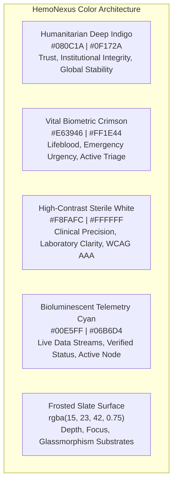

# 🌐 HemoNexus Global: Next-Generation Presentation Architecture
### Architectural Specification for Decoupled Frontend Modernization (UNESCO Social Infrastructure Project)

---

## 1. Executive Summary & Context

The **B24U Blood Donation Management System** currently runs as a monolithic Core PHP web application where the presentation layer (HTML5, Vanilla JS, Font Awesome 4.7.0, and inline CSS) is tightly coupled with procedural database calls and session manipulation. 

Under the mandate of an international social service initiative aligned with **UNESCO's Bioethics and Global Health Solidarity programs**, this specification outlines the complete re-architecting of the presentation layer into a decoupled, high-performance Single Page Application (SPA). 

> [!IMPORTANT]
> **Strict Operational Invariant**: The backend Core PHP processing scripts, procedural `mysqli` queries, MariaDB (`b24u`) schema, and native PHP session hydration (`$_SESSION` via `PHPSESSID`) **must remain 100% unaltered**. All modernization must occur purely within the decoupled frontend client and development server proxy pipeline.

---

## 2. Forensic Audit of Legacy Frontend Stack

The existing presentation layer was evaluated across architectural, security, accessibility, and user experience vectors:

```mermaid
graph LR
    subgraph Legacy["Legacy Monolithic Frontend"]
        HTML["HTML5 Templates (Mixed in .php)"]
        CSS["Vanilla CSS (Static & Inline)"]
        FA["Font Awesome 4.7.0 (CDN)"]
        VJS["Vanilla JS + jQuery 3.2.1"]
    end

    subgraph Coupling["Architectural Friction Points"]
        AlertFlow["alert() + window.location Redirects"]
        FormSubmit["Full Page POST Reloads"]
        RawDOM["Direct HTML String Concatenation"]
        HardcodedURL["Hardcoded Server Endpoints"]
    end

    subgraph Impact["Systemic Limitations"]
        UX["High Latency & Flicker"]
        A11y["Zero WCAG 2.1 Compliance"]
        Responsive["Fragile Media Queries"]
        State["Fragmented Client State"]
    end

    Legacy --> Coupling --> Impact
```



### Key Technical Deficits Identified:
1. **Procedural Script-Injection Redirects**:
   - The backend responds to POST requests with raw inline JavaScript strings (e.g., `<script> alert('Welcome ...'); window.location = 'donor_page.php'; </script>`). This prevents standard RESTful API consumption and forces browser tab context resets.
2. **Multipart & URL-Encoded Form Exclusivity**:
   - PHP's procedural engine populates `$_POST` strictly from `application/x-www-form-urlencoded` or `multipart/form-data`. Modern JSON `POST` bodies are ignored unless explicitly handled by the backend.
3. **Fragmented Navigation State**:
   - Three disconnected layout headers (`header.php`, `d_*.php`, `e_*.php`) with divergent navigation structures and inconsistent responsive hamburger behaviors.
4. **Visual & Accessibility Deficits**:
   - Lack of semantic landmarks (`<main>`, `<nav aria-label="...">`, `<section>`).
   - Insufficient contrast ratios in tables, raw alert popups, and unscaled mobile viewports.
   - Dated iconography restricted to Font Awesome 4.7.0 glyphs.

---

## 3. Brand Identity: HemoNexus Global (UNESCO Social Service Project)

The system is rebranded from the colloquial "B24U" to an authoritative, international social service platform:

```
        ╔══════════════════════════════════════════════════════════════╗
        ║                       H E M O N E X U S                      ║
        ║      Global Emergency Blood Grid & Biological Reserve        ║
        ║   Under the auspices of UNESCO Social Service Infrastructure ║
        ╚══════════════════════════════════════════════════════════════╝
```

- **Identity**: **HemoNexus Global** (or **HemoNexus Grid**)
- **Institutional Alignment**: UNESCO Global Healthcare Solidarity Directive.
- **Mission**: Facilitating real-time transnational and municipal blood allocation, connecting emergency wards, voluntary donors, and mobile drive coordinators under zero-margin clinical standards.
- **Design Metaphor**: A living, pulsating planetary vascular grid where every donor and blood component is treated as vital bio-infrastructure.

---

## 4. Futuristic UI Theme & Color Psychology

The visual system transitions from basic web colors to an institutional, futuristic medical HUD aesthetic:



### Color Specification & Accessibility Matrix

| Token | Hex / RGBA | Role & Psychology | Contrast (on #080C1A) |
| :--- | :--- | :--- | :--- |
| `--color-deep-indigo` | `#080C1A` | Canvas Background; symbolizes infinite humanitarian depth and steady governance. | Base |
| `--color-sub-indigo` | `#0F172A` | Card & Container Surfaces; provides architectural elevation and visual grounding. | 1.3:1 |
| `--color-vital-crimson` | `#E63946` | Primary Actions & Shortages; represents life-giving arterial blood and critical calls. | 4.8:1 (WCAG AA) |
| `--color-crimson-glow` | `#FF1E44` | Live Alarms & Urgent Badges; high-visibility beacon for acute shortages. | 5.6:1 (WCAG AA) |
| `--color-sterile-white` | `#F8FAFC` | Primary Typography & Metric Figures; crisp laboratory legibility. | 16.8:1 (WCAG AAA) |
| `--color-clinical-muted`| `#94A3B8` | Secondary Labels & Meta information; calm, neutral clinical gray. | 7.4:1 (WCAG AAA) |
| `--color-telemetry-cyan`| `#00E5FF` | Verified Connections, Event Progress, & Dynamic Node Telemetry. | 12.1:1 (WCAG AAA) |

### Design System Attributes:
- **Typography**: 
  - *Primary (Interface)*: `Plus Jakarta Sans` or `Inter` (geometric, highly legible humanist sans-serif).
  - *Data & Telemetry*: `JetBrains Mono` or `Space Grotesk` (used for Blood Groups `[O+]`, `[AB-]`, Donor IDs `#D-10492`, and pulse metrics).
- **Surface Elevation**: Multi-layered glassmorphic substrates with subtle 1px border glows (`border: 1px solid rgba(255, 255, 255, 0.08)` and `backdrop-filter: blur(16px)`).
- **Haptic/Micro-Visual Motion**: Subtle bioluminescent pulse animations on emergency blood requests indicating active triage urgency.

---

## 5. Decoupled SPA Architecture Plan

### Target Framework: React 19 + TypeScript + Vite + Tailwind CSS + Lucide Icons

```mermaid
graph TD
    subgraph Browser["User Browser (Single Page Application)"]
        SPA["React 19 SPA (Client-Side Routing: TanStack / React Router)"]
        Zustand["Global State Manager (Session, Donor Vitals, Alerts)"]
        Adapter["Legacy Bridge HTTP Adapter (Axios / Fetch)"]
    end

    subgraph DevProxy["Vite Dev Server Proxy (Port 5173)"]
        Proxy["Reverse Proxy (Forwarding with Cookie Preservation)"]
    end

    subgraph Backend["Existing Server Tier (Port 8000 / 80)"]
        PHP["Core PHP Scripts (login_donor.php, process.php, etc.)"]
        NativeSession["PHP Session Engine ($_SESSION via PHPSESSID)"]
        DB[("MariaDB (b24u)")]
    end

    SPA -->|Actions & Form Submits| Zustand
    Zustand --> Adapter
    Adapter -->|FormData + credentials: 'include'| Proxy
    Proxy -->|Local Loopback Proxy| PHP
    PHP <--> NativeSession
    PHP <--> DB
    PHP -->> Proxy: Raw HTML / JS Alert Response
    Proxy -->> Adapter: Forwarded Payload + Set-Cookie Header
    Adapter -->|Regex Response Interceptor| Zustand
    Zustand -->|Re-render View| SPA
```

---

## 6. The "Zero-Backend-Change" Legacy Bridge Adapter

Because the backend procedural PHP cannot be altered, the SPA requires a specialized communication adapter that operates under four core engineering principles:

### Principle 1: Reverse Proxy for Unified Origin (Cookie Integrity)
PHP's session management requires the `PHPSESSID` cookie to be transmitted automatically with every request. Modern cross-origin cookie policies (`SameSite`, CORS restrictions on `localhost`) can block session cookies between port `5173` and `8000`.

**Solution: Vite Reverse Proxy configuration (`vite.config.ts`)**:
```typescript
import { defineConfig } from 'vite';
import react from '@vitejs/plugin-react';

export default defineConfig({
  plugins: [react()],
  server: {
    port: 5173,
    proxy: {
      '/api': {
        target: 'http://localhost:8000',
        changeOrigin: true,
        rewrite: (path) => path.replace(/^\/api/, ''),
        configure: (proxy) => {
          proxy.on('proxyReq', (proxyReq) => {
            // Preserves standard multipart and form urlencoding
          });
        }
      }
    }
  }
});
```
This guarantees all client calls go to `http://localhost:5173/api/...`, making it completely same-origin. The browser natively manages `PHPSESSID` without CORS friction.

---

### Principle 2: Payload Serialization to `FormData`
PHP populates `$_POST` only when received as `multipart/form-data` or `application/x-www-form-urlencoded`. The SPA HTTP adapter automatically serializes JavaScript object models into `FormData` and injects required legacy submit tokens (e.g., `submit: "Login"`).

```typescript
// src/services/legacyAdapter.ts
export class LegacyBridge {
  static async post(endpoint: string, payload: Record<string, any>): Promise<LegacyResponse> {
    const formData = new FormData();
    Object.entries(payload).forEach(([key, value]) => {
      if (value !== undefined && value !== null) {
        formData.append(key, value.toString());
      }
    });

    const response = await fetch(`/api/${endpoint}`, {
      method: 'POST',
      body: formData,
      credentials: 'include' // Transmits and receives PHPSESSID
    });

    const rawText = await response.text();
    return this.parseLegacyResponse(rawText);
  }

  /**
   * Parses legacy PHP responses containing:
   * <script> alert('Message'); window.location = 'target.php'; </script>
   */
  private static parseLegacyResponse(html: string): LegacyResponse {
    const alertMatch = html.match(/alert\(['"]([^'"]+)['"]\)/i);
    const redirectMatch = html.match(/window\.location\s*=\s*['"]([^'"]+)['"]/i);

    const alertMessage = alertMatch ? alertMatch[1] : null;
    const redirectUrl = redirectMatch ? redirectMatch[1].trim() : null;

    // Detect error heuristics from legacy scripts
    const isError = !alertMessage || 
                    alertMessage.toLowerCase().includes('error') || 
                    alertMessage.toLowerCase().includes('does not match') ||
                    alertMessage.toLowerCase().includes('invalid');

    return {
      success: !isError,
      message: alertMessage || (isError ? 'Operation failed' : 'Operation completed'),
      redirectTarget: redirectUrl,
      rawHtml: html
    };
  }
}
```

---

### Principle 3: Client-Side Session Hydration & Scraping
Once authenticated via `login_donor.php`, the PHP session is stored on the server. Because the server does not expose a JSON `/me` endpoint, the SPA retrieves and parses the session profile by making a background `GET` request to `donor_page.php` or `health_report.php` through a lightweight DOM parser:

```typescript
// src/services/sessionScraper.ts
export async function scrapeDonorSession(): Promise<DonorProfile | null> {
  const response = await fetch('/api/donor_page.php', { credentials: 'include' });
  const html = await response.text();

  // If redirected or unauthenticated
  if (html.includes('login_donor.php') || !html.includes('mySidenav')) {
    return null;
  }

  const parser = new DOMParser();
  const doc = parser.parseFromString(html, 'text/html');

  // Extract hydrated session values from legacy sidebar layout
  const sidenav = doc.getElementById('mySidenav');
  if (!sidenav) return null;

  return {
    id: extractTextByIcon(sidenav, 'fa-id-card-o'),
    fullName: extractTextByIcon(sidenav, 'fa-user'),
    email: extractTextByIcon(sidenav, 'fa-envelope'),
    phone: extractTextByIcon(sidenav, 'fa-phone'),
    dateOfBirth: extractTextByIcon(sidenav, 'fa-calendar'),
    gender: extractTextByIcon(sidenav, 'fa-venus-mars'),
    bloodGroup: extractTextByIcon(sidenav, 'fa-tint'),
    city: extractTextByIcon(sidenav, 'fa-location-arrow'),
  };
}

function extractTextByIcon(container: HTMLElement, iconClass: string): string {
  const icon = container.querySelector(`i.${iconClass}`);
  return icon?.textContent?.replace(/\u00a0/g, ' ').trim() || '';
}
```

---

## 7. SPA Component & Directory Hierarchy

```
hemonexus-frontend/
├── public/
│   ├── favicon.svg              # Bioluminescent blood node logo
│   └── unesco-badge.svg         # Institutional endorsement seal
├── src/
│   ├── assets/                  # High-res vectors & clinical illustrations
│   ├── components/
│   │   ├── layout/
│   │   │   ├── NavigationBar.tsx      # Unified glassmorphic top navigation
│   │   │   ├── CommandDrawer.tsx      # Sidenav replacing legacy #mySidenav
│   │   │   └── GlobalFooter.tsx       # UNESCO compliance & legal footer
│   │   ├── ui/                        # Reusable design system primitives
│   │   │   ├── BloodBadge.tsx         # [O+], [A-] with pulse shortage glow
│   │   │   ├── MetricGauge.tsx        # Vitals dial (Hemoglobin, BP, Pulse)
│   │   │   ├── TriageAlert.tsx        # Urgent emergency broadcast banner
│   │   │   └── GlassCard.tsx          # Frosted slate card substrate
│   │   ├── modules/
│   │   │   ├── home/                  # Real-time donation camp telemetry & hero
│   │   │   ├── emergency/             # Blood request wizard & live triage grid
│   │   │   ├── donor/                 # Donor terminal, health cards, history
│   │   │   ├── camp/                  # Organizer camp desk, check-in kiosk
│   │   │   └── social/                # Contribute pledge & feedback conduits
│   ├── services/
│   │   ├── legacyAdapter.ts           # Zero-backend-change HTTP form dispatcher
│   │   └── sessionScraper.ts          # Session hydration & DOM scraper
│   ├── store/
│   │   ├── useSessionStore.ts         # Global active user & auth credentials
│   │   └── useEmergencyStore.ts       # Active hospital blood request queue
│   ├── types/
│   │   └── schema.d.ts                # TypeScript interfaces mapped to b24u
│   ├── App.tsx                        # Root layout & route switcher
│   ├── index.css                      # Tailwind CSS + custom HUD tokens
│   └── main.tsx                       # Entry point
├── vite.config.ts                     # Reverse proxy to PHP :8000
└── tailwind.config.js                 # HemoNexus color tokens & keyframes
```

---

## 8. Screen Modernization Roadmap

```mermaid
timeline
    title HemoNexus Presentation Modernization Phases
    section Phase 1: Foundation
      Vite + React Setup : Configure Proxy & Legacy Adapter
      Design Tokens : Define Humanitarian Indigos & Vital Crimsons
      Session Engine : Implement Scraping & Cookie Bridge
    section Phase 2: Public & Emergency
      Global HUD Portal : Replace index.php & blood_tips.php
      Emergency Grid : Modernize request_blood.php & pending_request.php
      Social Conduits : Modernize contribute.php & get_in_touch.php
    section Phase 3: Authenticated Portals
      Donor Command Center : Modernize donor_page.php & health_report.php
      Camp Check-in Kiosk : Modernize donor_entry.php & event_status.php
      Security Hardening : Add Client-side Form Safeguards
```

### Screen Comparison: Legacy vs. HemoNexus Global

| Legacy Screen | Legacy Limitations | HemoNexus Global Solution |
| :--- | :--- | :--- |
| **`index.php`** | Static 4-image slide show, plain table | **Global Biometric Map & Camp Radar**: Interactive regional map showing live blood reserves, ongoing donation drives, and real-time urgency metrics. |
| **`request_blood.php`** | Unresponsive form with hardcoded captcha | **Emergency Triage Request Wizard**: Multi-step rapid intake form with automatic compatibility verification and geolocation picker. |
| **`pending_request.php`** | Raw HTML table with text status | **Live Hospital Dispatch Grid**: High-contrast card grid sorted by triage urgency, blood type compatibility badges, and instant claim action. |
| **`donor_page.php`** | Static HTML table and plain sidebar | **Donor Biometric Dashboard**: Personal impact statistics (lives touched, milliliters donated), digital donor identity card, and health trend graphs. |
| **`donor_entry.php`** | Manual ID form with basic table | **Camp Reception Kiosk**: High-speed donor check-in terminal with automatic vitals assessment and real-time camp blood bag counters. |
