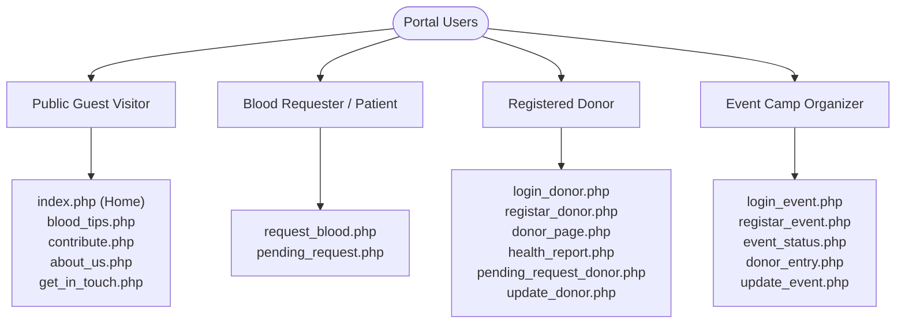
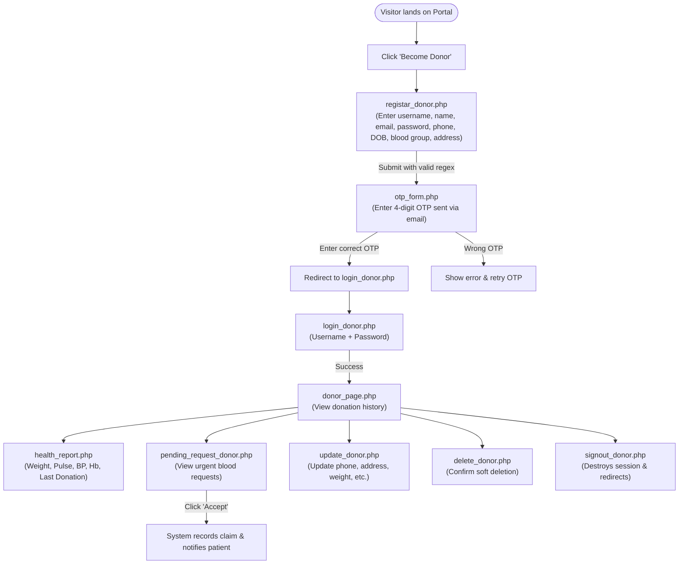
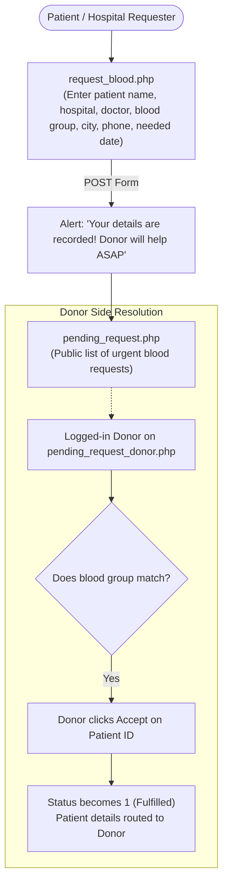
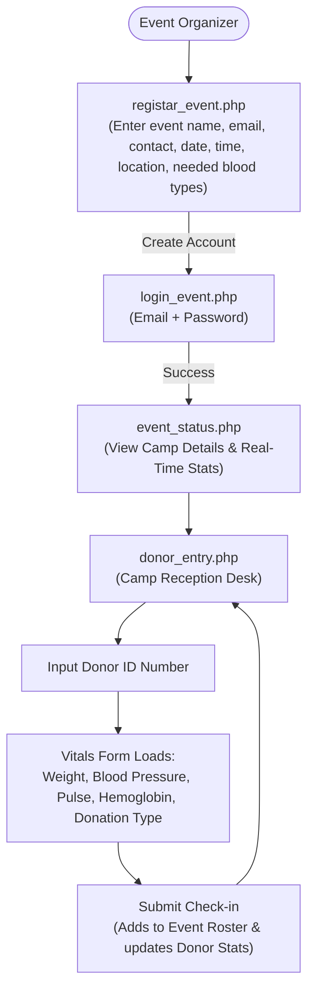

# 🖥️ Frontend Workflow — B24U Blood Donation Management System

This document outlines the user interface structure, page flows, client-side validation logic, navigation trees, and visual interaction states implemented in the B24U frontend.

---

## 👥 User Personas & Navigation Profiles

The system serves four primary user personas, each interacting through specialized presentation layouts:



---

## 📐 Layout Architecture

The presentation layer utilizes three standard layout patterns based on authentication states:

### 1. Public Visitor Layout (`header.php` + `footer.php`)
- **Top Navigation Bar**: Brand logo, quick action buttons (`Login`, `Become Donor`), responsive hamburger icon.
- **Dropdown Menus**:
  - *Request Portal*: `request_blood.php`, `pending_request.php`
  - *Event Portal*: `registar_event.php`, `login_event.php`
  - *More*: `about_us.php`, `get_in_touch.php`
- **Responsive Navigation Script**:
  ```javascript
  function responcenav() {
      var temp = document.getElementById('responcenav');
      temp.style.display = (temp.style.display == 'block') ? 'none' : 'block';
  }
  ```

### 2. Donor Dashboard Layout (`donor_page.php`, `health_report.php`, `d_*.php`)
- **Persistent Header with Profile Sidebar Trigger (`openNav()`)**.
- **Sliding Sidenav Drawer (`#mySidenav`)**:
  - Profile ID (`$_SESSION['id']`)
  - Full Name, Email, Phone Number, Date of Birth, Gender, Blood Group, City
  - Edit Profile Icon (`update_donor.php`)
  - Delete Account Icon (`delete_donor.php`)
  - Sign Out Button (`signout_donor.php`)
- **Sub-Navigation Tabs**:
  - *Donor History* (`donor_page.php`)
  - *Health Report* (`health_report.php`)
  - *Pending Requests* (`pending_request_donor.php`)
  - *Blood Tips* (`d_blood_tips.php`)
  - *Contribute* (`d_contribute.php`)

### 3. Event Organizer Layout (`event_status.php`, `donor_entry.php`, `e_*.php`)
- **Event Header with Sidenav Trigger**.
- **Sliding Sidenav Drawer (`#mySidenav`)**:
  - Organizer ID, Organizer Name, Email, Phone
  - Event Date, Event Timing (Start - End), City
  - Edit Event Icon (`update_event.php`)
  - Delete Event Icon (`delete_event.php`)
  - Sign Out Button (`signout_event.php`)
- **Sub-Navigation Tabs**:
  - *Event Status* (`event_status.php`)
  - *Donor Entry* (`donor_entry.php`)
  - *Blood Tips* (`e_blood_tips.php`)
  - *Contribute* (`e_contribute.php`)

---

## 🔄 Detailed Frontend Page Workflows

### 1. Donor Lifecycle Workflow



### 2. Blood Request & Patient Flow



### 3. Event Camp Organizer Flow



---

## 🛡️ Client-Side Validation Rules

All forms enforce strict HTML5 patterns and JavaScript constraints prior to submission:

| Form Field | Target Page | HTML5 Regex / Rule | User Constraint |
| :--- | :--- | :--- | :--- |
| **Username** | `registar_donor.php` | `^[A-Za-z0-9._%+-@]{5,10}$` | 5–10 characters, alphanumeric & symbols |
| **Full Name** | `registar_donor.php`, `registar_event.php` | `[A-z ]+$` | Alphabetic characters & whitespace only |
| **Email** | All forms | `[A-Za-z0-9._%+-]+@[A-z0-9.-]+\.[a-z]{2,}$` | Standard RFC 5322 email syntax |
| **Password** | `registar_donor.php`, `registar_event.php` | `(?=.*\d)(?=.*[a-z])(?=.*[A-Z]).{6,}` | At least 1 digit, 1 lowercase, 1 uppercase, minimum 6 characters |
| **Mobile Number** | All forms | `^[0-9]{10}$` | Exactly 10 numeric digits |
| **Pincode** | Registration & Contribution | `^[0-9]{6}$` | Exactly 6 numeric digits |
| **Required Date** | `request_blood.php` | `min="YYYY-MM-DD"` | Must be current date or future date |
| **OTP Input** | `otp_form.php`, `otp_form_donor.php` | `pattern="[0-9]{4}" maxlength="4"` | Exactly 4 numeric digits |

---

## 🎨 Asset & Styling Architecture

- **Cascading Style Sheets (`/CSS/`)**:
  - `styleindex.css`: Slideshow carousel, responsive card grid for recent events, responsive breakpoint queries (`@media screen and (max-width: 768px)`).
  - `styleregisterdonor.css` & `styleregisterevent.css`: Split container (promotional left pane + scrollable multi-step registration table).
  - `styledonorhistory.css` & `stylehealthreport.css`: Tabbed dashboard styling with full-width responsive tables and metric badges.
  - `stylecontactus.css` & `stylecontribute.css`: Contact card grid and payment pledge layout.
- **Icons & Typography**:
  - Font Awesome 4.7.0 (`cdnjs.cloudflare.com/ajax/libs/font-awesome/4.7.0/css/font-awesome.min.css`).
  - Google Web Fonts: Roboto & Poppins.
