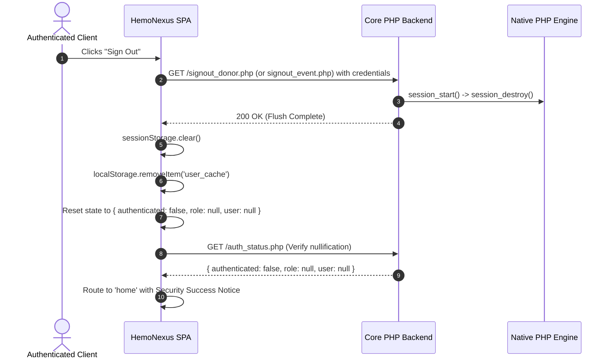

# 🛡️ Security Architecture & Authentication Navigation Guards
### Full-Stack Security Specification for B24U / HemoNexus Global (UNESCO Social Service Bio-Grid)

---

## 1. Security Architecture Overview

The **HemoNexus Global** presentation tier interfaces with legacy procedural Core PHP backend scripts (`login_donor.php`, `login_event.php`, `signout_donor.php`, `signout_event.php`) that maintain authenticated state strictly within server-side memory via native PHP sessions (`$_SESSION`) and the `PHPSESSID` session cookie.

To enforce complete protection across both client-side Single Page Application (SPA) navigation and server-side operations without modifying legacy backend execution logic, a **State-Synchronized Navigation Guard Architecture** has been deployed.

```mermaid
flowchart TD
    subgraph Client["Client-Side Presentation Layer"]
        NavEvent[User Navigates to Route] --> Guard{Route Guard Interceptor}
        Guard -->|Public Route| AllowPublic[Allow Render: Home, Tips, Emergency]
        Guard -->|Guest Only Route| CheckGuest{Already Authenticated?}
        CheckGuest -->|Yes| RedirectWorkspace[Redirect to Authorized Workspace]
        CheckGuest -->|No| AllowGuest[Allow Render: Login Gateways, Stepper]

        Guard -->|Protected Route| RoleCheck{Inspect Active Role}
        RoleCheck -->|Unauthenticated| InterceptGuest["Capture Intended Route<br>Redirect to Futuristic Login Gateway"]
        RoleCheck -->|Cross-Role Tampering| InterceptTampering["Security Violation Alert<br>Enforce Strict Workspace Isolation"]
        RoleCheck -->|Role Authorized| AllowAuthorized[Render Protected Command Center]
    end

    subgraph Sync["Session Synchronization Engine"]
        Heartbeat[45s Background Watchdog] --> ProbeGateway["GET /auth_status.php<br>(credentials: 'include')"]
        BootSync[Application Initialization] --> ProbeGateway
        LoginAction[Post Credentials] --> ProbeGateway
        LogoutAction[Sign Out Trigger] --> FlushSession["GET /signout_*.php<br>+ Client Storage Purge"]
    end

    subgraph Server["Core PHP Backend Tier"]
        AuthStatus["auth_status.php<br>(Read-only Session Introspection)"]
        LegacyDonor["login_donor.php<br>(Hydrates $_SESSION)"]
        LegacyEvent["login_event.php<br>(Hydrates $_SESSION)"]
        LegacySignout["signout_*.php<br>(session_destroy())"]
        NativeSession[("Native PHP Session Storage<br>($_SESSION via PHPSESSID)")]
    end

    ProbeGateway <--> AuthStatus
    AuthStatus <--> NativeSession
    LoginAction --> LegacyDonor
    LoginAction --> LegacyEvent
    LegacyDonor --> NativeSession
    LegacyEvent --> NativeSession
    FlushSession --> LegacySignout
    LegacySignout --> NativeSession
```



---

## 2. Route Protection & Role Isolation Matrix

The application partitions all views into four discrete authorization tiers:

| Route ID | Category | Required Role | Unauthenticated Policy | Cross-Role Access Policy |
| :--- | :--- | :--- | :--- | :--- |
| `home` | **Public** | Any (Guest/User) | Direct Access Allowed | N/A |
| `emergency` | **Public** | Any (Guest/User) | Direct Access Allowed | N/A |
| `camps` | **Public** | Any (Guest/User) | Direct Access Allowed | N/A |
| `tips` | **Public** | Any (Guest/User) | Direct Access Allowed | N/A |
| `contribute` | **Public** | Any (Guest/User) | Direct Access Allowed | N/A |
| `donor-login` | **Gateway** | Unauthenticated | Direct Access Allowed | Redirect to `donor-dashboard` |
| `organizer-login` | **Gateway** | Unauthenticated | Direct Access Allowed | Redirect to `event-dashboard` |
| `donor-stepper` | **Onboarding**| Unauthenticated | Direct Access Allowed | Redirect to `donor-dashboard` |
| `donor-dashboard`| **Protected**| `donor` | Intercept ➔ Route to `donor-login` | Violation ➔ Redirect to `event-dashboard` |
| `donor-history` | **Protected**| `donor` | Intercept ➔ Route to `donor-login` | Violation ➔ Redirect to `event-dashboard` |
| `donor-health` | **Protected**| `donor` | Intercept ➔ Route to `donor-login` | Violation ➔ Redirect to `event-dashboard` |
| `donor-requests`| **Protected**| `donor` | Intercept ➔ Route to `donor-login` | Violation ➔ Redirect to `event-dashboard` |
| `event-dashboard`| **Protected**| `organizer` | Intercept ➔ Route to `organizer-login` | Violation ➔ Redirect to `donor-dashboard` |
| `camp-kiosk` | **Protected**| `organizer` | Intercept ➔ Route to `organizer-login` | Violation ➔ Redirect to `donor-dashboard` |
| `camp-roster` | **Protected**| `organizer` | Intercept ➔ Route to `organizer-login` | Violation ➔ Redirect to `donor-dashboard` |

---

## 3. Strict Workspace Isolation Protocol

To prevent cross-contamination between voluntary donors and clinical drive administrators:

1. **Role Identification**:
   - Donors are strictly typed by the existence of `$_SESSION['user_name']` and `$_SESSION['id']`.
   - Event Organizers are strictly typed by the existence of `$_SESSION['user_email']` and the explicit absence of `$_SESSION['user_name']`.
2. **Tampering Interception**:
   - If an authenticated Donor navigates to `event-dashboard` or attempts to invoke camp reception kiosks (`donor_entry.php`), the Route Guard fires a **Strict Workspace Isolation Violation**. Access is denied, an alert banner is displayed, and the client view is constrained to `donor-dashboard`.
   - If an authenticated Organizer attempts to enter the personal Donor Terminal, access is similarly blocked and constrained to `event-dashboard`.

---

## 4. Full-Stack Session Synchronization Pipeline

### Gateway Introspection (`auth_status.php`)
A lightweight, zero-modification introspection script inspects native PHP session variables and returns clean JSON without altering legacy code:

```php
// B24U_CorePHP_SourceFile/auth_status.php
session_start();
header('Content-Type: application/json');
header('Cache-Control: no-store, no-cache, must-revalidate, max-age=0');

if (!empty($_SESSION['user_name']) && !empty($_SESSION['id'])) {
    echo json_encode([
        'authenticated' => true,
        'role' => 'donor',
        'session_id' => session_id(),
        'user' => [
            'id' => strval($_SESSION['id']),
            'userName' => strval($_SESSION['user_name']),
            'userFullName' => strval($_SESSION['user_full_name']),
            'bloodGroup' => strval($_SESSION['blood_group']),
            'totalDonation' => intval($_SESSION['total_donation']),
            // ...
        ]
    ]);
    exit;
}

if (!empty($_SESSION['user_email']) && empty($_SESSION['user_name']) && !empty($_SESSION['id'])) {
    echo json_encode([
        'authenticated' => true,
        'role' => 'organizer',
        'session_id' => session_id(),
        'user' => [
            'id' => strval($_SESSION['id']),
            'userFullName' => strval($_SESSION['user_full_name']),
            'userEmail' => strval($_SESSION['user_email']),
            // ...
        ]
    ]);
    exit;
}

echo json_encode(['authenticated' => false, 'role' => null, 'user' => null]);
```

---

## 5. Session Flush & Logout Hardening

When a user triggers Sign Out from either workspace:



---

## 6. Background Watchdog (Inactivity Heartbeat)

To prevent session desynchronization caused by server-side timeouts or concurrent tab termination:
- A background timer queries `/auth_status.php` every **45 seconds**.
- If the server session expires (`authenticated: false`) while the client still holds active state, the watchdog triggers an automatic local state purge, displays a **Session Expired** notice, and redirects the user to the login gateway.
