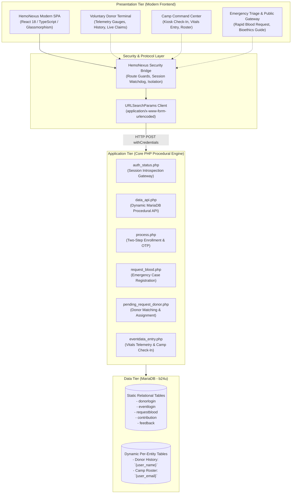

# HEMONEXUS
**UNESCO-Inspired Planetary Bio-Solidarity Grid & Emergency Blood Allocation Management System**

---

## 🌍 Executive Overview

**HemoNexus Global** is a modernized, enterprise-grade healthcare management solution engineered to modernize legacy blood banking infrastructure into a zero-latency planetary coordination grid. Inspired by **UNESCO Bioethics & Social Service principles**, HemoNexus bridges public voluntary blood donors, municipal emergency trauma wards, and mobile clinical camps into a unified, high-contrast command center.

The application combines a high-performance **decoupled reactive Single Page Application (SPA)** with a procedural **Core PHP & MariaDB backend**, strictly preserving procedural business logic and native session hydration (`$_SESSION`) while delivering an ultra-modern user experience.

---

## 🏗️ System Architecture



---

## ✨ Key Features

1. **Futuristic UNESCO-Themed UI**:
   - Deep humanitarian indigo background (`#080C1A`), vital arterial crimson accents (`#E63946`), high-contrast medical cyans (`#00E5FF`), and clinical greens (`#10B981`).
   - Frosted glassmorphic panels, responsive data grids, and telemetry vital gauges for Weight, Blood Pressure, Pulse, and Hemoglobin.

2. **Strict Workspace Isolation & Navigation Guards**:
   - Client-side navigation guards continuously synchronize with backend `$_SESSION` via `/auth_status.php`.
   - Complete workspace isolation prevents logged-in donors from accessing organizer views and vice versa.
   - Watchdog heartbeat monitors server-side timeouts every 45s.

3. **Seamless Two-Step Biometric Registration**:
   - Replaces full-page reloads with an interactive 4-step stepper component.
   - Automatically handles OTP validation via `process.php` (`submit: 'Sucess'`).

4. **Live Dynamic Data Bridge (`data_api.php`)**:
   - Serves real-time queries directly from `b24u.requestblood`, `{donor_username}`, and `{event_email}` without altering procedural PHP patterns.
   - Auto-lookup for Donor IDs in the Camp Reception Kiosk.

5. **Dual Dynamic Table Inserts**:
   - Camp check-in updates `donorlogin` vitals, appends the attendance record to `{donor_username}`, and records the clinical entry in `{event_email}`.

---

## 📂 Project Repository Structure

```text
├── Blood-Donation-PHP/              # Core PHP Backend & Integrated Modern SPA
│   └── B24U_CorePHP_SourceFile/     # Procedural PHP source code
│       ├── hemonexus/               # Deployed standalone HemoNexus Modern SPA
│       │   └── index.html           # Production-ready Single Page Application
│       ├── auth_status.php          # Session introspection API
│       ├── data_api.php             # Dynamic MariaDB procedural API bridge
│       ├── process.php              # Two-Step registration & OTP processor
│       ├── request_blood.php        # Emergency blood request dispatcher
│       ├── pending_request_donor.php# Donor claim & matching handler
│       ├── eventdata_entry.php      # Camp reception vitals entry
│       ├── connection.php           # Database connection handler
│       └── ...                      # Legacy Core PHP modules
│
├── hemonexus-frontend/              # Modular React 19 + TypeScript codebase
│   ├── src/                         # Reusable UI components & services
│   │   ├── services/api.ts          # URLSearchParams HTTP client & API bindings
│   │   └── types/index.ts           # Full TypeScript interface definitions
│   ├── dev-server.mjs               # Zero-native proxy dev server (Port 3000)
│   └── package.json                 # Project manifest
│
├── workflows/                       # System architecture & technical workflows
│   ├── README.md                    # Workflows directory index
│   ├── frontend-workflow.md         # Frontend presentation tier workflow
│   ├── backend-workflow.md          # Backend procedural PHP execution cycle
│   ├── database-workflow.md         # Database ERD & table lifecycle workflow
│   ├── frontend-modernization-architecture.md # Modernization & UI architecture
│   ├── security-authentication-workflow.md    # Security guards & session hydration
│   └── data-integration-workflow.md # URLSearchParams data integration contract
│
├── .gitignore                       # Clean repository exclusions
└── README.md                        # Master project documentation
```

---

## 🚀 Quickstart & Setup Guide

### 1. Prerequisites
* **PHP 8.0+** (or XAMPP with PHP enabled)
* **MySQL / MariaDB** (Default XAMPP configuration on port 3306)
* **Node.js 18+** (Optional, for running the port 3000 frontend server)

### 2. Database Initialization
1. Start the MariaDB daemon on `localhost:3306`.
2. Import the schema and seed data into database `b24u`:
   ```bash
   mysql -u root -p < "Blood-Donation-PHP/b24u.sql"
   ```

### 3. Running the Backend Server
Start the built-in PHP development server targeting the Core PHP source directory:
```bash
php -S localhost:8000 -t "Blood-Donation-PHP/B24U_CorePHP_SourceFile"
```

### 4. Running the Frontend
* **Direct Access via Backend (Port 8000)**:  
  Navigate to: **[http://localhost:8000/hemonexus/](http://localhost:8000/hemonexus/)**
* **Dedicated Frontend Server (Port 3000)**:  
  ```bash
  node "hemonexus-frontend/dev-server.mjs"
  ```
  Navigate to: **[http://localhost:3000/](http://localhost:3000/)**

---

## 🔑 Pre-Seeded Test Credentials

| Portal / Workspace | Role | Username / Email | Password |
| :--- | :--- | :--- | :--- |
| **Donor Terminal** | Voluntary Blood Donor | `testdonor` | `Password123` |
| **Camp Command** | Certified Event Organizer | `organizer@unesco.org` | `Password123` |

---

## 📜 Technical Workflows & Blueprints

For in-depth architectural and sequence diagrams, refer to the [`workflows/`](workflows/) directory:
* [Frontend Modernization Architecture](workflows/frontend-modernization-architecture.md)
* [Security & Session Authentication Workflow](workflows/security-authentication-workflow.md)
* [Frontend Data Integration Workflow](workflows/data-integration-workflow.md)
* [Backend Procedural Execution Lifecycle](workflows/backend-workflow.md)
* [Database ERD & Dynamic Tables Workflow](workflows/database-workflow.md)

---

## 🛡️ License & Acknowledgements
Developed as part of the **UNESCO-Inspired Social Service Healthcare Modernization Initiative**.
Powered by procedural Core PHP, MariaDB, and modern React glassmorphic design.
